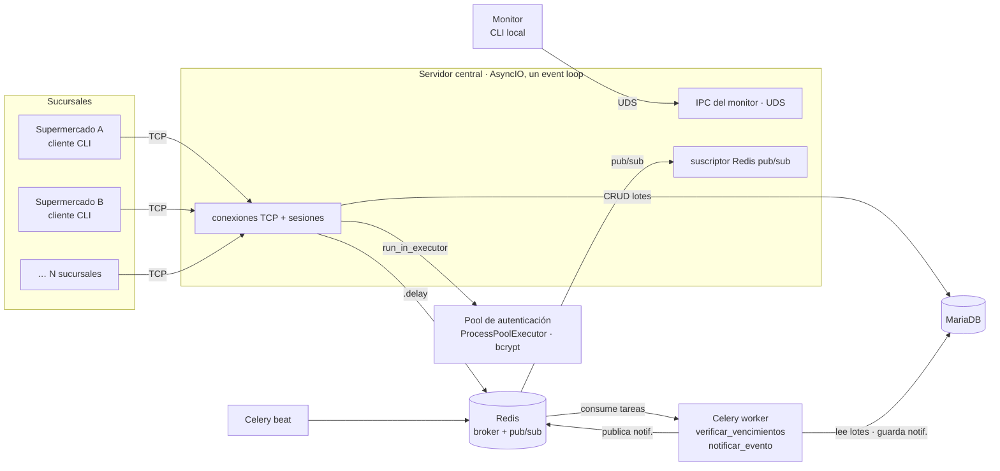
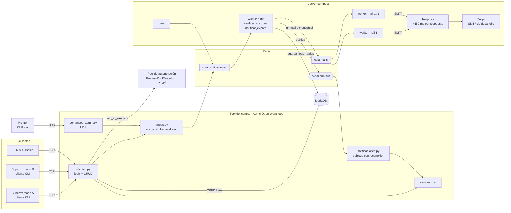

# FreshNotify

Sistema distribuido de gestión de vencimientos de **lotes de alimentos para supermercados**.
Proyecto final de **Computación II (2038)** — Ingeniería en Informática, Universidad de Mendoza.

## El problema

Un supermercado maneja muchos lotes de productos perecederos, cada uno con su fecha de
vencimiento. Controlarlos a mano lleva tiempo y es fácil que se escape alguno, y un lote vencido
en góndola es plata perdida y un riesgo para el cliente.

La idea de FreshNotify es que cada sucursal cargue sus lotes y que el sistema revise los
vencimientos solo, avisando en el momento cuando un lote está por vencer (cada sucursal elige
con cuántos días de anticipación).

## Arquitectura

- **Servidor central** (AsyncIO): acepta múltiples supermercados concurrentes por TCP, despacha
  operaciones CRUD y reenvía notificaciones en tiempo real.
- **Cliente CLI** (uno por sucursal): gestiona el inventario de lotes por TCP.
- **Monitor administrativo**: registra supermercados (con credencial) y consulta estadísticas
  vía Unix Domain Socket.
- **Workers de Celery** sobre **Redis**, en contenedores y con dos colas: `notificaciones`
  (avisos en vivo y revisión de vencimientos) y `mails` (resumen al encargado de cada sucursal).
  **Beat** lanza la revisión cada 30 s y la limpieza diaria.
- **Pool de autenticación** (`ProcessPoolExecutor`): verifica hashes bcrypt (CPU-bound) en
  procesos aparte, con semáforo de admisión y contadores en memoria compartida.
- **MariaDB**: persistencia relacional (supermercados → lotes → notificaciones).
- **SMTP**: en desarrollo, Mailpit (no envía nada afuera) detrás de Toxiproxy, que le agrega la
  latencia de un proveedor real.

### Antes: un worker para todo

Así era en la etapa 2. Un solo worker hacía todo: la revisión de vencimientos de todas las
sucursales en una tarea y los avisos de cada operación.



### Ahora: workers por cola, en contenedores



### Qué cambió y por qué

- **Dos colas.** Los avisos son cortos y la sucursal los espera en el momento; los mails
  dependen de un servidor externo y tardan ~1 s cada uno. En una sola cola un aviso queda
  atrás de todos los mails pendientes (27 s contra 0,03 s, ver Resultados).
- **Workers en contenedores, escalables por cola.** Los mails pasan casi todo el tiempo
  esperando la red, así que con más procesos esperando a la vez salen más por segundo:
  `docker compose up -d --scale worker-mail=4`. Todos comparten el mismo Redis y nunca se
  hablan entre sí.
- **Revisión de a una sucursal por tarea.** `verificar_vencimientos` ya no revisa todo: encola
  una `verificar_sucursal` por sucursal y así se reparten entre los workers.
- **Tareas que se pueden repetir.** Con varios workers dos pueden revisar la misma sucursal a
  la vez, y con `acks_late` una tarea de un worker que se cae la vuelve a hacer otro. Para que
  eso no duplique avisos: un `UNIQUE (supermercado_id, clave)` en notificaciones, bajas con
  `UPDATE … AND activo = TRUE` y la baja y su aviso en una misma transacción.
- **Reintentos** ante MariaDB o Redis caídos (backoff exponencial con jitter, distinto según
  la tarea) y ante el SMTP caído en los mails.
- **El servidor se separó en módulos** (antes `server.py` hacía todo): sesiones, atención de
  clientes, notificaciones, comandos del monitor y cola de tareas. `server.py` solo arma las
  piezas y maneja el arranque y el apagado.
- **Más robusto:** protocolo con tiempo máximo y esquema por acción, errores con código
  (`protocolo`, `base_datos`, `autenticacion`, `interno`), reconexión a Redis, apagado ordenado
  con SIGINT/SIGTERM y encolado que no frena el event loop si Redis no contesta.

### Resultados

Medidos con 50 sucursales simuladas (3 lotes por vencer cada una: 150 avisos y 50 mails por
revisión), 150 ms de latencia por respuesta del SMTP (~1,1 s por mail) y 2 procesos por
contenedor.

| Prueba | Resultado |
|---|---|
| Aviso detrás de 50 mails, **una sola cola** | la 🔔 tarda **27,0 s** |
| Aviso detrás de 50 mails, **colas separadas** | la 🔔 tarda **0,03 s** |
| Revisión completa, 1 worker-mail | avisos en 0,58 s · mails en **27,4 s** |
| Revisión completa, 2 worker-mail | avisos en 0,47 s · mails en **14,1 s** |
| Revisión completa, 4 worker-mail | avisos en 0,73 s · mails en **7,9 s** |
| Ráfaga de 50 mails, 4 worker-mail | 7,7 s, repartidos 13 / 12 / 12 / 13 |
| Se mata un worker-mail a mitad de la ráfaga | llegan los 50, ninguno repetido (los 2 que tenía se reenvían a los ~90 s) |
| SMTP cortado 12 s / 60 s | llegan 10 de 10 en los dos casos |
| MariaDB apagada mientras el worker procesa un aviso | reintenta (2, 4, 7 s…) y lo guarda una vez cuando vuelve |
| Redis apagado con el servidor andando | las sucursales siguen recibiendo respuesta (3 ms) y la 🔔 vuelve sola cuando vuelve Redis |

## Protocolo

Cada mensaje es un JSON precedido por 4 bytes con su largo (big-endian), hasta 10 MB.

- Una vez que llega el primer byte, el resto tiene que llegar en 10 s; si no, se cierra la
  conexión (un cliente colgado no ocupa una sesión para siempre).
- Cada acción tiene su esquema (`src/shared/esquemas.py`): campos, tipos y cuáles son
  obligatorios. Un mensaje que no cumple se contesta con error y la sesión sigue; un largo
  imposible o un mensaje cortado deja el stream desincronizado y ahí sí se cierra.
- Los errores llevan un código para que el cliente sepa qué pasó sin leer el texto:

```json
{"tipo": "respuesta", "ok": false, "error": "base_datos",
 "mensaje": "No se pudo acceder a la base de datos. Probá de nuevo en un momento."}
```

| Código | Cuándo | ¿Sigue la sesión? |
|---|---|---|
| `protocolo` | JSON roto, no es un objeto, no cumple el esquema | sí (no, si el stream quedó desincronizado) |
| `base_datos` | MariaDB caída o la conexión se cortó | sí, se reconecta en el próximo pedido |
| `autenticacion` | el pool de procesos falló al verificar | se rechaza el login, se puede reintentar |
| `interno` | cualquier otro error (el detalle queda en el log, no se manda) | sí |

## Pendiente

- Dockerizar el servidor, el monitor y el cliente (hoy corren en la máquina)
- Pasar las pruebas de punta a punta a tests automáticos

## Cómo correr

Requisitos: Docker y Python 3.11+.

```bash
# 1. MariaDB, Redis, los workers, beat, Mailpit y Toxiproxy
docker compose up -d

# 2. Dependencias
python3 -m venv .venv && source .venv/bin/activate
pip install -r requirements.txt

# 3. Servidor (con el venv activado)
python -m src.server.server

# 4. Cliente (datos de ejemplo: "Super Vea Centro" o "Atomo Guaymallen", contraseña "1234")
python -m src.client.client

# 5. Monitor administrativo (alta de supermercados, estadísticas, forzar tareas)
python -m src.monitor.monitor
```

Para escalar los workers de mail: `docker compose up -d --scale worker-mail=N`. Los mails
enviados se pueden ver en la interfaz de Mailpit (http://localhost:8025).

Si la base ya estaba creada con una versión anterior (el esquema solo se carga con el volumen
vacío), hay que aplicar la migración:

```bash
docker compose exec -T mariadb mariadb -ufresh_user -pfresh_pass fresh_db < docker/actualizar_base.sql
```

## Estructura

```
src/
├── server/
│   ├── server.py          arranque y apagado: arma las piezas y maneja las señales
│   ├── clientes.py        login y pedidos de cada sucursal
│   ├── sesiones.py        sesiones activas (una por sucursal)
│   ├── notificaciones.py  encola los avisos y reenvía los que llegan por Redis
│   ├── comandos_admin.py  comandos del monitor por el socket Unix
│   ├── tareas.py          encola en Celery sin frenar el event loop
│   └── errores.py         códigos de error y respuestas
├── client/          cliente CLI (menú + escucha de notificaciones push)
├── monitor/         monitor administrativo (UDS, request-response)
├── auth/            pool de autenticación: procesos, semáforo, memoria compartida
├── workers/         Celery: tareas, colas y simulación de carga
├── shared/          config, protocolo (framing), esquemas por acción, logger
└── infrastructure/  conexiones a MariaDB/Redis + repositorios por entidad
```
